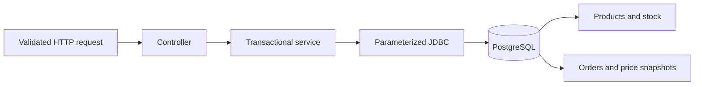

# Inventory & Order API

An original Java/Spring Boot portfolio demo by Solomon Tomy. All products and records are fictional. No employer source code, customer data, or marketplace credentials are included.

## What it demonstrates
- PostgreSQL persistence with versioned Flyway migrations.
- Validated product creation, bounded pagination, atomic restocking.
- Multi-line orders with transactional stock deductions and price snapshots.
- Conditional SQL updates prevent overselling; sorted product IDs keep row-lock acquisition consistent.
- Unique order references reject duplicate submissions with HTTP 409. This is duplicate prevention, not replay-style idempotency.
- Cancellation locks the order and restores stock exactly once.
- RFC 9457-style problem responses for invalid input, missing records and conflicts.
- Integration tests run against real PostgreSQL, including simultaneous orders and transaction rollback.

## Run locally
Requirements: JDK 21, Maven 3.6.3+, Docker Compose (or a local PostgreSQL instance).

```sh
docker compose up -d
mvn spring-boot:run -Dspring-boot.run.profiles=demo
```

The API listens at `http://127.0.0.1:8080`. The demo profile adds three fictional products. The default profile creates only the schema. Currency is AED throughout this demo; prices use decimal arithmetic.

Without Docker, create a separate database and set `DB_URL`, `DB_USER`, and `DB_PASSWORD`. Defaults target the demo database on port 5433; do not point this project at an existing business database. No production authentication is implemented; the server binds to loopback by default.

## Try the API
```sh
curl http://localhost:8080/api/products
curl -X POST http://localhost:8080/api/orders -H 'Content-Type: application/json' -d '{"reference":"DEMO-ORDER-001","lines":[{"productId":1,"quantity":2}]}'
# Use the returned order UUID:
curl http://localhost:8080/api/orders/ORDER_UUID
curl -X POST http://localhost:8080/api/orders/ORDER_UUID/cancel
```
On PowerShell use `Invoke-RestMethod` or `curl.exe` with appropriate JSON quoting. See `examples/demo.ps1` for a runnable Windows example.

| Method | Path | Behavior |
|---|---|---|
| GET | `/api/products?limit=20&offset=0` | List products, maximum 100 per page |
| POST | `/api/products` | Create `{sku,name,price,stock}`; 201 + Location |
| GET | `/api/products/{id}` | Product details |
| POST | `/api/products/{id}/restock` | Add `{quantity}` atomically |
| POST | `/api/orders` | Place `{reference,lines:[{productId,quantity}]}` |
| GET | `/api/orders/{id}` | Read lines, price snapshots and total |
| POST | `/api/orders/{id}/cancel` | Cancel and restore inventory once |

## Test
Tests truncate their database between cases. Always use a dedicated test database.

```sh
docker compose exec db createdb -U demo inventory_demo_test
mvn verify
```

Override `TEST_DB_URL`, `TEST_DB_USER`, and `TEST_DB_PASSWORD` for a local PostgreSQL server. CI provisions an isolated PostgreSQL service and runs the same suite. Build a runnable JAR with `mvn package`; launch with `java -jar target/inventory-order-demo-1.0.0.jar --spring.profiles.active=demo`.

## Design


Spring JDBC makes the stock mutation and locking semantics explicit. Database checks provide a second line of validation. A failed order rolls back its header, lines, and all earlier stock deductions. There is no payment processing, tax calculation, customer PII, marketplace integration, or production authentication in this intentionally bounded demo.

Framework baseline: Spring Boot 3.5.16 / Java 21. See [Spring Boot requirements](https://docs.spring.io/spring-boot/3.5/system-requirements.html). Keep dependencies updated and add authentication, authorization, observability and deployment hardening before adapting this example for production.
